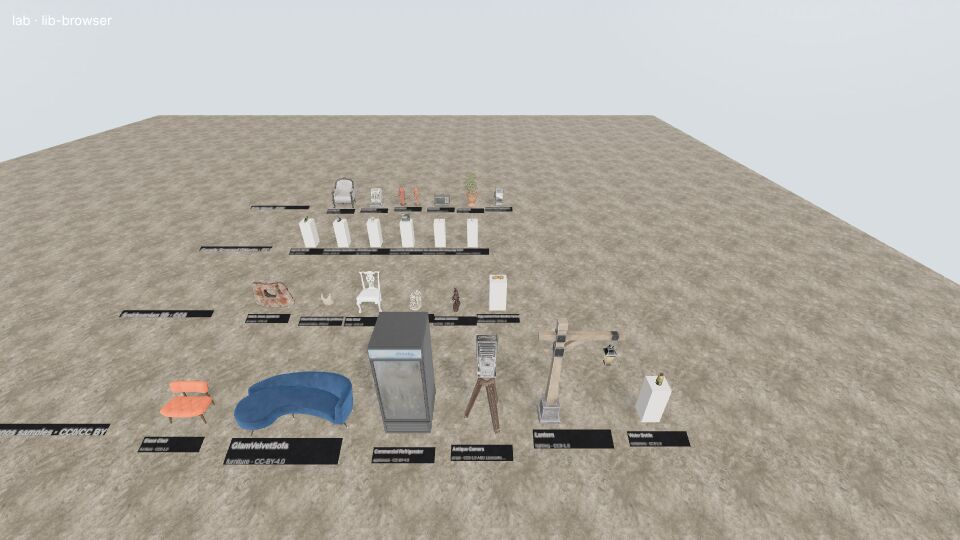
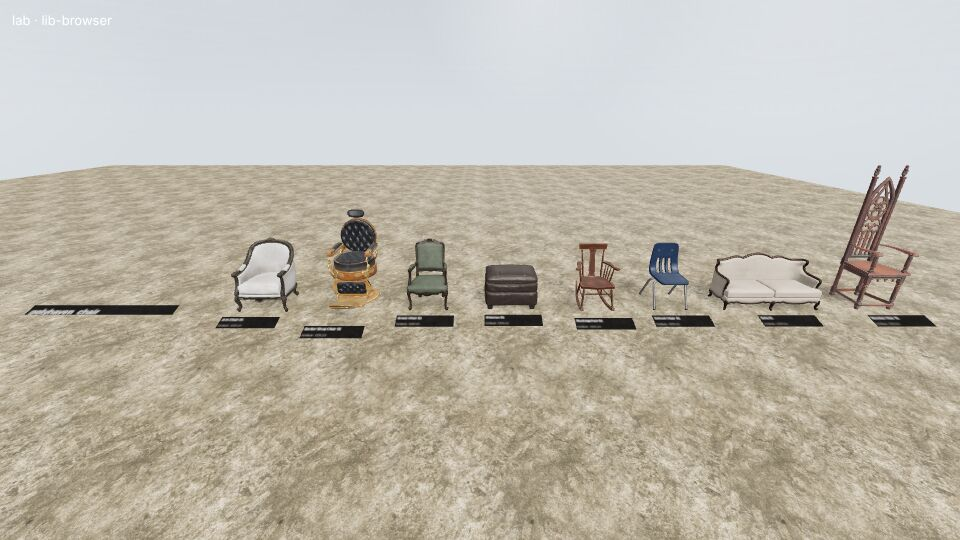
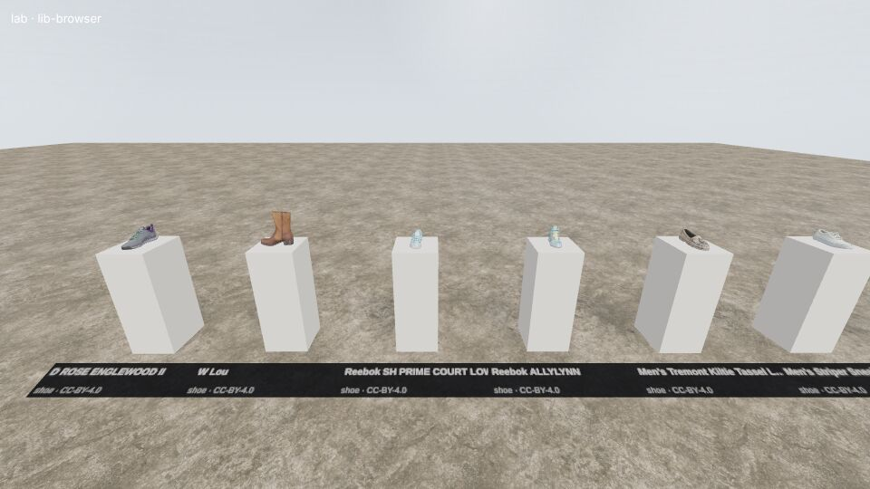
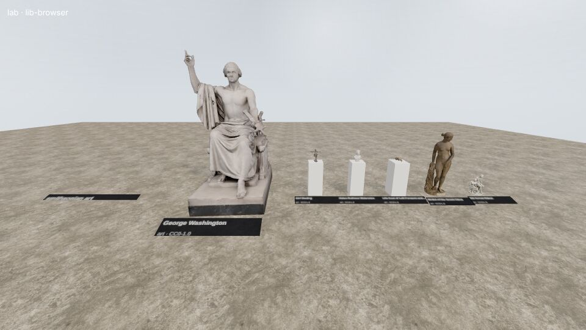

# Third-party 3D model libraries

What large, openly licensed 3D model libraries we can stream into the browser, how good they are,
and how the other areas (vehicles, people, street props, museum, shops, interiors) can use them.

Owner files: `src/libraries.ts`, `scripts/libraries/*`, `public/libraries/*.json`, `src/lab/lib-browser.ts`.

## Ranked sources

Checked November 2026. "CORS" means a browser page on another origin can fetch the files directly
(`bash scripts/libraries/cors-check.sh URL` prints the `access-control-allow-origin` header).
Only CC0 and CC-BY are usable (docs/AGENTS.md); NC/ND and custom non-commercial terms are excluded.

| # | Source | Licence | Size | Formats | CORS / API | Realism | Best for | Status |
|---|---|---|---|---|---|---|---|---|
| 1 | **Poly Haven models** | CC0 | 521 | glTF + JPG (1k/2k/4k/8k), FBX, blend | ✔ `api.polyhaven.com` + `dl.polyhaven.org`, open JSON API | Photoreal, hand-made, real-scale, PBR | furniture, street props, tools, lights, plants, food, decor | **ingested** (`polyhaven`) |
| 2 | **Google Scanned Objects** | CC BY 4.0 | 1,033 | GLB (meshopt + WebP, 2k) + 3 LODs, via HF `codepawl/scanned-objects-glb`; originals OBJ+PNG on Gazebo Fuel | ✔ (HF and Fuel both send `ACAO: *`) | Photo-scanned real products, true metres | shop shelves: shoes, toys, kitchenware, electronics, boxed food, bags | **ingested** (`gso`) |
| 3 | **Smithsonian 3D (Open Access)** | CC0 | ~3,580 packages (3,481 with a web GLB) | Draco GLB (Thumb 20k / Low / Medium / High), USDZ, OBJ zips; Voyager `document.json` per package | ✔ `3d-api.si.edu` (file search API, no key). Its WAF blocks *HeadlessChrome* UAs; scripts/shot.mjs proxies it | Museum-grade scans: aircraft, spacecraft, statues, busts, vases, fossils, shells, coral | **museum** | **ingested** (`smithsonian`, sharded) |
| 4 | **Khronos glTF-Sample-Assets** | per model; CC0 / CC BY 4.0 kept | ~150 (31 kept) | GLB / glTF | ✔ raw.githubusercontent.com, jsDelivr | Very high (showcase PBR: sofas, chair, fridge, lamps, camera, helmet) | interiors, shops, museum showpieces | **ingested** (`khronos`) |
| 5 | Objaverse 1.0 | per object (CC-BY, CC0, some NC/ND → filter) | 800k | GLB | ✔ HF | Very mixed | everything (already used via sand3d + src/detail.ts) | already in project |
| 6 | NASA 3D Resources | NASA media guidelines (US gov, no copyright; no endorsement) | ~400 | GLB on `assets.science.nasa.gov`, GitHub `nasa/NASA-3D-Resources` (3ds/obj/blend) | ✔ (`ACAO: *` on assets.science.nasa.gov) | Good spacecraft/rovers/buildings, mixed | museum space wing | candidate: page scrape needed for an index |
| 7 | Sketchfab (CC0 / CC-BY downloadable) | CC0/CC-BY per model | ~1M downloadable | glTF zip | Search API is open with CORS; **download needs an API token** (`/v3/models/{uid}/download` → 401) | Very mixed, many superb scans | anything; best ad-hoc source | needs `request_credential` for api.sketchfab.com; models must then be mirrored |
| 8 | Quaternius | CC0 | ~1,100 | GLB/FBX zips; per-model GLBs on quaternius.trebeljahr.com | ✗ (no ACAO on the mirror) | Low-poly, stylised | not our look; crowds/animals placeholders | not ingested |
| 9 | Kenney | CC0 | 270+ packs | GLB/FBX/OBJ in zips (kenney.nl, itch.io) | ✗ zips only | Low-poly, stylised | not our look | not ingested |
| 10 | Poly Pizza | CC0 / CC-BY (Google Poly archive, Kenney, Quaternius) | ~10k | GLB | API needs key (401); static CDN 403 without referer | Low-poly | — | not ingested |
| 11 | three.js example models | mixed, mostly CC-BY/CC0 per file, some unclear | ~60 | GLB | ✔ threejs.org | Showcase | demos only | not ingested (licences per file) |
| 12 | OmniObject3D | CC BY 4.0 | 6,000 scans, 190 categories | OBJ/PLY, 1.2 TB, OpenDataLab login | ✗ | Photo-scans, good | shop goods, food, toys | candidate for a curated, converted subset in public/assets/library/ |
| 13 | BlenderKit (free) | “Royalty Free” (not CC) except a CC0 subset | 30k+ | .blend only, API key | ✗ | High | — | not browser-usable |
| 14 | OpenGameArt | mixed (CC0, CC-BY, GPL, CC-BY-SA) | ~5k 3D | mixed | ✗ | Stylised, uneven | — | not ingested |
| 15 | ambientCG | CC0 | few 3D models (mostly materials) | zip | ✗ (no ACAO on API) | Good | materials (src/pbr.ts covers Poly Haven) | not ingested |
| — | Thingiverse / Printables | mixed, many NC | millions | STL (no textures) | ✗ | Untextured | — | excluded |
| — | ShapeNet | research-only terms | 51k | OBJ | ✗ | Low | — | **excluded** (non-commercial) |
| — | Amazon Berkeley Objects (ABO) | CC BY-NC 4.0 | 8k | GLB | — | High | — | **excluded** (NC) |
| — | 3D-FUTURE, HSSD, Meta DTC | non-commercial | — | — | — | — | — | **excluded** |

Reference images looked at: the GSO "every object" sheet
(https://huggingface.co/datasets/codepawl/scanned-objects-glb/resolve/main/assets/all_objects.jpg — real retail
packaging, shoes, toys, kitchenware, consistently lit, true-colour), Poly Haven thumbnails
(`https://cdn.polyhaven.com/asset_img/thumbs/<id>.png`) and the lab screenshots below.

### Notes per ingested source

- **Poly Haven**: catalog sizes come from the API's `dimensions` (millimetres, Blender axes x, y=depth, z=up →
  stored as [x, height, depth] metres). The glTF's relative texture paths do not match the CDN layout, so the
  loader fetches `api.polyhaven.com/files/<id>` and rewrites buffer/image URIs (1k textures by default).
  Some ids are scenes/sets (`WoodenChair_01` is a set; coastal cliffs are 50–90 m): filter with `maxSize`.
- **Google Scanned Objects**: the HF conversion (codepawl) keeps the full 16.7 M triangles but compresses to
  345 MB total (~300 KB per object), Y-up metres. `lods/<id>_lod1..3.glb` are simplified levels
  (`quality: 'low'` → lod 2). Categories: shoe 254, toy 224, household 102, electronics 97, kitchen 80,
  food and drink 71, health and beauty 55, bottles and cups 37, board game 33, bag 30, media 29.
  Brands/logos on packaging belong to their owners (fine for a shop scene; don't imply endorsement).
- **Smithsonian**: the builder pages `3d-api.si.edu/api/v1.0/content/file/search` (41k file rows) and reads each
  package's Voyager `document.json` for **units** (mm/cm/in/m), the model **rotation**, multi-part placement,
  bounding box and EDAN record id. So every entry has a true size in metres (Wright Flyer 12.3 m span,
  Bell X-1 8.6 × 10.4 m, Greenough's George Washington 3.7 m). Categories come from the Smithsonian unit
  (NASM → `air-space`, NMAH → `american-history`, NMAAHC → `african-american`, Cooper Hewitt → `design`,
  NPG → `portraits`, SAAM/Hirshhorn → `art`, Freer|Sackler → `asian-art`) and, for natural history, from title
  rules (`fossil`, `bone` = skulls/skeletons only, `shell`, `coral`, `animal`, `specimen`).
  Web GLBs are ~150k faces with 2k textures: use `quality: 'low'` (the 20k-face Thumb GLB) beyond a few metres.
  Full object records (description, date, materials) via `api.si.edu/openaccess/api/v1.0/content/<edan>`
  need a free api.data.gov key.
- **Khronos**: hand-picked realistic models only, licences read from each `metadata.json`; models not built to
  real scale get a real largest-dimension override in `KH_REAL` (scripts/libraries/build_catalogs.py).

## Catalogs

`python3 scripts/libraries/build_catalogs.py [polyhaven gso smithsonian khronos]` rewrites
`public/libraries/` (1.1 MB in total; Smithsonian is sharded per category so a scene only fetches what it needs).
Entry fields: `id, t (title), c (category), tags, lic, by, u (model, relative to base), s ([x, y-up, z] metres),
th (thumbnail), tri, kb`, plus Smithsonian `q` (rotation), `f` (metres per unit), `parts`, `lo` (low-poly GLB), `edan`.

## How to use (for the other areas)

```ts
import { searchLibrary, loadCatalog, loadLibraryModel, libraryInfo, attribution } from '../libraries';

// search: source(s), exact category, words in title/tags, size bounds (largest dimension, metres), triangle cap
const hits = await searchLibrary({ source: 'gso', category: 'shoe', limit: 12, seed: 42 });
const obj = await loadLibraryModel(hits[0]);       // THREE.Group: metres, centred on x/z, base at y=0
obj.position.set(x, shelfY, z);
obj.userData.size;                                  // Vector3, metres
obj.userData.attribution;                           // credit line for the UI / CREDITS.md

await loadLibraryModel(e, { height: 0.9 });          // force a height instead of the real size
await loadLibraryModel(e, { quality: 'low' });       // cheap version for distance / repeats
await libraryInfo('smithsonian');                    // name, licence, count, categories
```

`loadLibraryModel` caches per entry and returns clones that share geometry and materials, so repeating one
model is cheap in memory; for many copies, pull the meshes out and instance them. `initDetail(renderer)`
must have run (it does in main.ts). Models stream from the source CDNs; nothing is committed.
Credit CC-BY models (GSO, some Khronos) on screen or in CREDITS.md using `attribution(entry)`.

| Area | Use | Example |
|---|---|---|
| **Shops** (src/shop.ts) | GSO is a ready-made stock room: shoes for shoe stores, boxed toys, kitchenware, bottles/cups, electronics, packaged food, health & beauty. Poly Haven for store fixtures (cash register, shelves, crates). | `searchLibrary({ source: 'gso', category: ['food and drink', 'health and beauty'] })`, `searchLibrary({ source: 'polyhaven', text: 'cash register' })` |
| **Museum** (src/museum.ts) | Smithsonian: aircraft and spacecraft (`air-space`), statues/busts (`art`, `portraits`), Chinese bronzes and vases (`asian-art`), Cooper Hewitt chairs (`design`), fossils, skulls, shells, coral cabinets. Poly Haven statues (`marble_bust_01`, `bronze_*_statue`, `gothic_statue`). Khronos `AntiqueCamera`, `MosquitoInAmber`. | `searchLibrary({ source: 'smithsonian', category: 'fossil' })`, `loadLibraryModel(e, { quality: 'low' })` for far exhibits |
| **Interiors** (src/interior.ts) | Poly Haven furniture (sofas, armchairs, tables, beds, cabinets, lamps, chandeliers, picture frames, plants, books), Khronos `SheenWoodLeatherSofa`, `GlamVelvetSofa`, `SheenChair`, `ChairDamaskPurplegold`, `CommercialRefrigerator`; GSO for clutter (mugs, shoes, toys, electronics). | `searchLibrary({ source: 'polyhaven', category: 'furniture', maxSize: 2.5 })`, `searchLibrary({ source: 'gso', category: 'kitchen', limit: 6 })` |
| **Street props** (src/nyc/streetprops.ts) | Poly Haven: `fire_hydrant`, `metal_trash_can`, `concrete_road_barrier(_02)`, `korean_public_payphone_01`, `exterior_aircon_unit`, `modular_fire_escape`, `modular_electricity_poles`, `modular_street_seating`, `WetFloorSign_01`, `cardboard_box_01`, `planter_box_*`, `potted_plant_*`, `old_tyre`. | `searchLibrary({ source: 'polyhaven', anyOf: ['hydrant', 'trash', 'barrier', 'bench', 'planter'] })` |
| **Vehicles** (src/nyc/vehicles.ts) | Few in these libraries: Poly Haven `covered_car`, `hand_truck`, `CoffeeCart_01`; Khronos `CarConcept` (CC-BY, concept car, 4.4 m); Smithsonian `air-space` for museum planes. Real NYC cars need Sketchfab (API token) or Objaverse. | `searchLibrary({ source: 'polyhaven', category: 'vehicles & transport' })` |
| **People** (src/nyc/people.ts) | None of the photoreal sources has people (Khronos `CesiumMan` is a rigged low-detail test figure, CC-BY). For people use Objaverse / Sketchfab CC-BY scans or Quaternius (stylised). Smithsonian `portraits` + `art` have life-size statues and costumes on forms. | — |

### Lab

`/?lab=lib-browser` — one row per source at real scale, labelled (title, category, licence, dimensions);
items under 45 cm stand on 0.9 m plinths.
`&src=gso&category=shoe&n=16&wrap=8`, `&src=ph&q=chair` (use `ph`, `si`, `kh` aliases: scripts/shot.mjs proxies
every URL containing "polyhaven", including the page's own), `&src=si&id=<uuid>`, `&detail=low|full`.

Screenshots (software rendering, `--quality low`):

-  overview: Poly Haven, GSO (on plinths), Smithsonian, Khronos rows
-  `&src=ph&q=chair`
-  `&src=gso&category=shoe`
-  `&src=si&category=art&detail=low`: Greenough's 3.7 m George Washington next to small bronzes

Performance: a Smithsonian Medium GLB is ~150k faces + 2k textures, GSO ~10–40k faces, Poly Haven 1–30k.
The overview (24 models, Smithsonian/GSO at `low`) is 142 draw calls / 1.25 M triangles.

## Unfinished / next

- NASA 3D Resources (~400 GLBs with CORS on assets.science.nasa.gov) — needs an index scraped from
  science.nasa.gov/3d-resources pages.
- Sketchfab CC0/CC-BY: ask for an API token (request_credential for api.sketchfab.com), then mirror selected
  models (download URLs are signed and expire) into public/assets/library/sketchfab/ with credits.
- OmniObject3D (CC BY 4.0): curated, converted subset (food, fruit, toys) would complement GSO.
- Smithsonian full metadata (descriptions for museum labels) via api.si.edu with an api.data.gov key.
