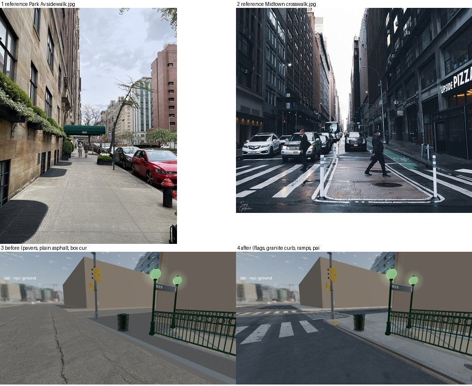

# NYC ground surfaces: sidewalks, curbs, roadway, markings

Research for `src/nyc/ground.ts` (lab: `?lab=nyc-ground`). Everything below is what the code copies.

## Reference photos (looked at, Wikimedia Commons)

| What | URL | Notes taken |
|---|---|---|
| Park Av sidewalk, UES | https://commons.wikimedia.org/wiki/File:820_Park_Avenue_sidewalk,_Lenox_Hill,_Upper_East_Side,_Manhattan,_Apr_21_2024.jpg | Light grey broom-finished concrete flags ~5 ft square, joints a thin dark line; flags differ in tone (some yellowish, some cooler, newer ones lighter); a cross-scored joint line every flag; steel-faced curb with a light top; dark rubber mats, hydrant at the kerb |
| 90 St north sidewalk, Cooper Hewitt | https://commons.wikimedia.org/wiki/File:90th_Street_between_5th_Av_and_Madison,_north_sidewalk,_Cooper_Hewitt_Museum,_Manhattan,_New_York.jpg | Older, darker concrete: mottled grey‑brown, worn polish in the walking line, dark stains; joints every ~1.5 m across the walk, long joint parallel to the kerb |
| Times Sq / 7 Av from above (55 St) | https://commons.wikimedia.org/wiki/File:Sidewalk_system_in_Manhattan_55th_Street_New_York_City.jpg | Plan view: crosswalks as wide white bars in line with the sidewalks, stop bars ~1.2 m before them, broken white lane lines, utility-cut patches (lighter/darker rectangles), manholes in the lanes, round covers in the sidewalk |
| Crosswalk, Midtown side street (wet) | https://commons.wikimedia.org/wiki/File:Crosswalk_(52007281982).jpg | High-visibility "zebra" bars ~0.6 m wide with ~0.6–0.9 m gaps, ~3 m long; worn at wheel tracks; dark wet asphalt, painted pedestrian island outline, manhole |
| Crosswalk, 8 Av / Penn Station | https://commons.wikimedia.org/wiki/File:Crosswalk_(52018908982).jpg | Same bars, edges ragged where tyres wear them; stop bar a solid white band across the lanes; double white and lane arrows |
| Thermoplastic close-up, W 26 St & 10 Av | https://commons.wikimedia.org/wiki/File:Toynbee_Tile_in_crosswalk_W_26th_St_and_10th_Ave.jpg | Thermoplastic bars ~2 ft wide, crazed with hairline cracks into plates, chipped edges with asphalt showing; aggregate asphalt mid grey with lighter stones |
| Red bus lane, 14 St / Union Sq | https://commons.wikimedia.org/wiki/File:Red_Lane_(51221422848).jpg | Terracotta-red lane (not bright red): ~#9b4a3f in sun, worn darker in wheel paths, black patches where the red is gone; bordered by a solid white line on the traffic side and broken white on the other; "BUS ONLY" letters in white |
| Sidewalk cellar doors | https://commons.wikimedia.org/wiki/File:On_The_Streets_of_NYC_(4534848957).jpg | Two steel leaves ~0.9 m each, ~1.5–1.8 m long, frame flush with the concrete, rust-brown worn steel; surrounding concrete patched and stained; dark gum spots everywhere |
| Subway vent grate (from below) | https://commons.wikimedia.org/wiki/File:NYC_Subway_grate_vc.jpg and https://commons.wikimedia.org/wiki/File:Astor_Place_grate_vc.jpg | Steel bar grating ~2.5 cm pitch, panels ~1.2 m wide in long runs on a steel frame; looking down you see black void |
| Fiber-optic manhole | https://commons.wikimedia.org/wiki/File:Stealth_Fiber-Optic_Manhole_Cover_in_NYC.jpg | Cast-iron covers with raised waffle/diamond relief, dark grey with polished high points |

(Thumbnails were fetched with the Commons API and viewed; not committed.)

## Specifications (NYC DOT Highway Rules / Street Design Manual, MUTCD, observation)

### Sidewalk
- **Flags 5 ft × 5 ft (1.52 m)** "where feasible", otherwise adjusted to be as near to 5 ft as possible; cross-flag scoring runs at 90° to the building line and curb (NYC DOT Highway Rules, sidewalk amendment: https://www.nyc.gov/html/dot/downloads/pdf/hwyrules_amend_sidewalk.pdf). Our 4.5 m sidewalk = 3 flags of 1.5 m from the kerb.
- Sidewalk 4 in (residential) to 7 in thick concrete (NYC DDC standard highway details: https://nyc.gov/assets/ddc/downloads/publications/infrastructure/hwy_std_constr_details_100701.pdf).
- Joints: tooled scoring lines ~6–10 mm, filled with dirt (dark); every ~20 ft a premoulded expansion joint ~12 mm with black asphalt filler.
- Finish: light broom across the walk. Standard grey: in sun sRGB ≈ (176,173,166) new, (140,136,128) old/dirty. Some districts have **tinted dark charcoal concrete with silicon carbide sparkle** (Street Design Manual 3.1.2 "Concrete, Dark Tinted"); a few have sand-coloured or exposed-aggregate concrete (SDM 3.1.3 / 3.1.4). Implemented: per-block style grey / tinted / sand.
- Flag-to-flag variation is strong: individual flags get replaced, so tone jumps flag by flag; replaced flags are lighter and cleaner.
- Defects: hairline cracks across a flag (corner to edge), small chipped corners, dark round **gum spots** (5–20 mm, dense near doors and corners), oil/coffee stains, rust stains near standpipes, tar-patched cracks.

### Curb
- **Curb height 6–7 in (0.15–0.18 m)** reveal; world uses CURB = 0.15 m.
- **Granite curb** (SDM 3.2.1) — grey speckled granite blocks 6–8 ft long, top ~6–8 in wide, rough-dressed face; or **steel-faced concrete curb** (SDM 3.2.2) with a steel angle along the top outer edge (common in Manhattan; dark rusty line on the edge).
- Corner radii in Manhattan are tight, ~5–15 ft; world uses 1.2 m to keep crosswalks and ramps on the straight kerb.

### Pedestrian ramps (ADA)
- One ramp per crosswalk, aligned with it, running slope ≤ 1:12 (0.15 m drop → 1.8 m run), ≥ 4 ft (1.22 m) clear width, side flares ≤ 1:10.
- **Detectable warning surface: truncated domes**, 24 in (0.61 m) deep across the full ramp width at the bottom; domes 0.9 in base / 0.45 in top diameter, 0.2 in high, 1.6–2.4 in centre spacing. NYC uses mostly **safety yellow** pads (newer), and older dark cast-iron or brick-red ones.

### Roadway and markings (MUTCD + NYC practice, observed)
- Asphalt mid–dark grey, sRGB ≈ (70,70,72) worn, (40,40,42) fresh/wet; visibly lighter aggregate.
- **Utility-cut patches**: rectangular, sharp saw-cut edges, darker (newer) or lighter (older) than surrounding asphalt, often outlined with black tar seal; very common along the curb lanes and across streets.
- **Crack sealant**: black glossy tar lines, ~3–5 cm wide, meandering, often longitudinal along lane joints.
- **Wheel tracks**: two lighter, polished bands per lane ~0.6 m wide at ±0.8 m from lane centre; **oil drip strip** darker down the lane centre.
- Gutter: last 0.3–0.6 m along the kerb collects grit, leaves, cigarette butts and wet stains; **catch basins** at the corners just upstream of crosswalks: cast-iron grate ~0.6 × 0.9 m with curb inlet.
- **High-visibility crosswalk** ("zebra"/continental): longitudinal white bars ~2 ft (0.6 m) wide with 2–3 ft gaps, 10–15 ft long, in line with the sidewalk; NYC uses thermoplastic that crazes and chips.
- **Stop bar**: solid white 12–24 in (0.3–0.6 m) wide, ~4 ft (1.2 m) before the crosswalk, across approach lanes only.
- **Lane lines**: 4–6 in (0.10–0.15 m) wide. Broken white 10 ft dash / 30 ft gap between same-direction lanes (Manhattan avenues are one-way). Double yellow (two 4 in lines with 4 in gap) on two-way streets.
- **Bus lanes**: terracotta red (SDM: "red-colored pavement is to be used for bus lanes"), white "BUS ONLY" legend 8 ft letters; solid white line on the traffic side.
- Pavement legends ("ONLY", "BUS", "STOP") are elongated: letters ~8 ft (2.4 m) tall, ~0.6 m wide.

### Sidewalk fixtures
- **Diamond-plate cellar doors**: pairs of steel leaves, total ~1.5–1.8 m × 1.2–1.5 m, against the building line in front of shops; rusty brown-grey, worn shiny on the high points.
- **Vault lights** (SoHo/Tribeca cast-iron districts): cast-iron panels with round glass prisms (~5–8 cm discs, ~10 cm pitch), purple-tinted old glass, often patched with concrete; strips 1–1.5 m wide along the building line.
- **Subway ventilation grates**: steel bar grating panels ~1.2 m wide in runs of 3–10 m along the kerb side of avenue sidewalks.
- **Utility covers**: Con Edison rectangular ~0.6 × 0.9 m service boxes with diamond tread, round water-valve boxes (~0.25 m, "WATER"), Empire City Subway/Verizon rectangular hatches; cast-iron, dark.

### Belgian block
- Granite setts ~5 × 10 in (0.13 × 0.25 m) laid in rows across the street, used on old streets in SoHo, Tribeca, Meatpacking, DUMBO; dark grey‑brown, rounded wear, dirty joints. Implemented as a street-surface option for the "village" blocks.

## Textures used (CC0, Poly Haven, packed by the ground code into one RGBA map each: albedo luminance, roughness, normal xy)
- Sidewalk concrete: `asphalt_04` (a smooth grey concrete-like surface, 4 m) — https://polyhaven.com/a/asphalt_04
- Roadway: `asphalt_01` (2.08 m) — https://polyhaven.com/a/asphalt_01
- Curb granite: `concrete_floor_01` (speckled aggregate) — https://polyhaven.com/a/concrete_floor_01
- Belgian block: `cobblestone_floor_05` — https://polyhaven.com/a/cobblestone_floor_05

Colour is applied in the shader (per flag / per block), the photo only supplies luminance detail, so different sources share one consistent palette. Each flag samples the concrete map at its own random offset so neighbouring flags never repeat.

## Before / after

Lab `?lab=nyc-ground&cam=54.5,1.6,18&look=49.5,0.2,25` with `&before=1` (the previous look, rebuilt with the old materials: paver-pattern sidewalk scan, plain asphalt scan, box curbs; no paint) and without (current). References: Park Av sidewalk and a Midtown crosswalk (links above).
