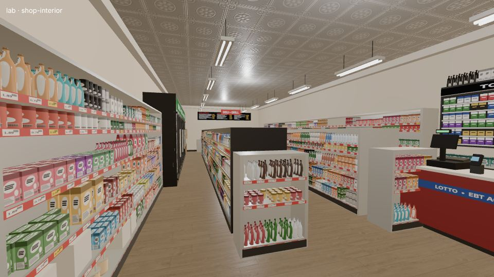
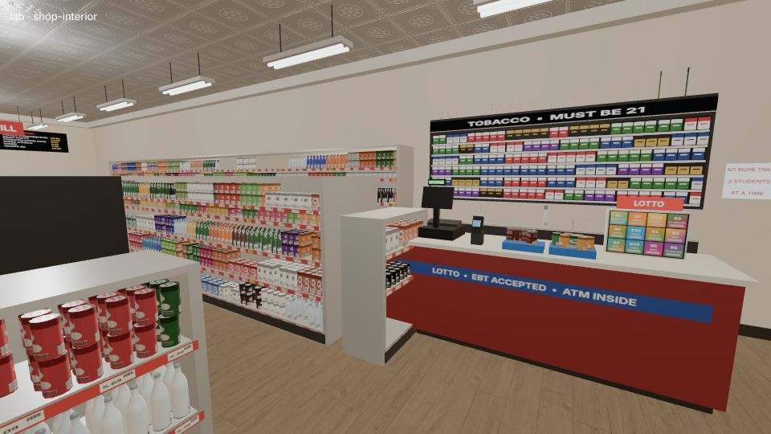
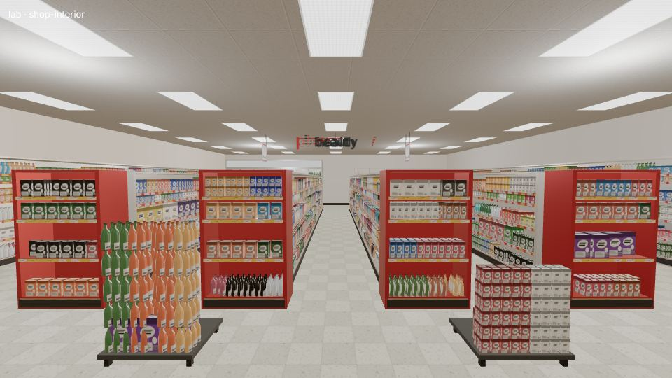
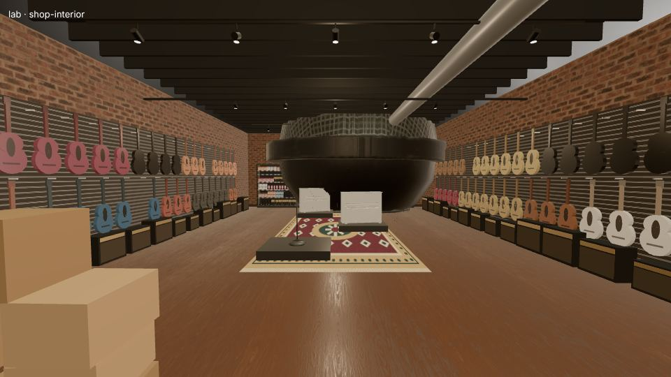
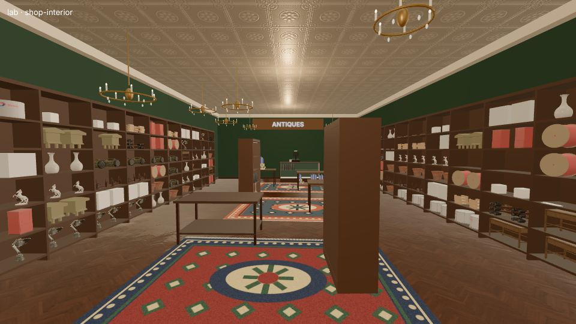
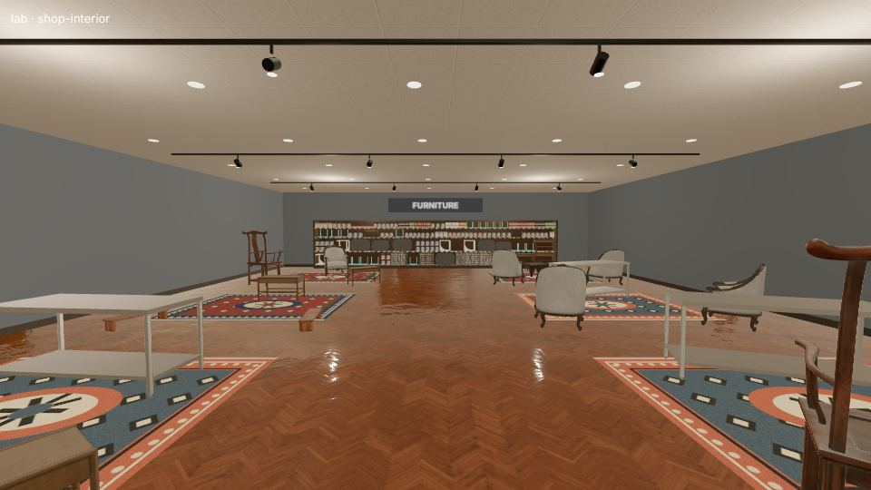
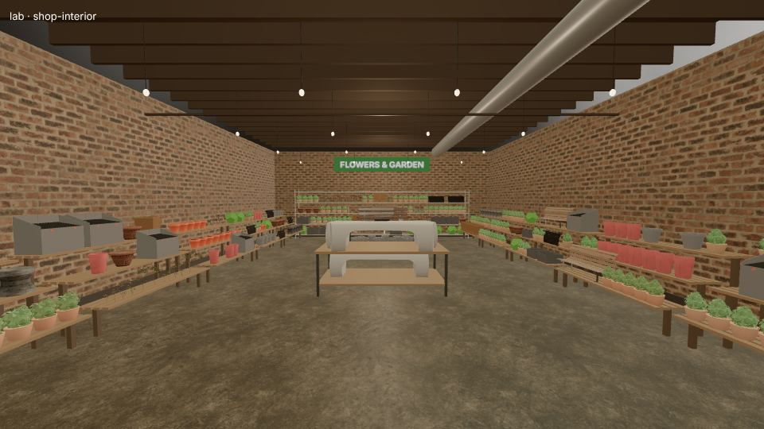
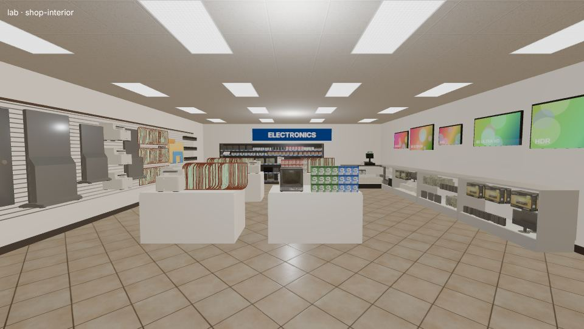
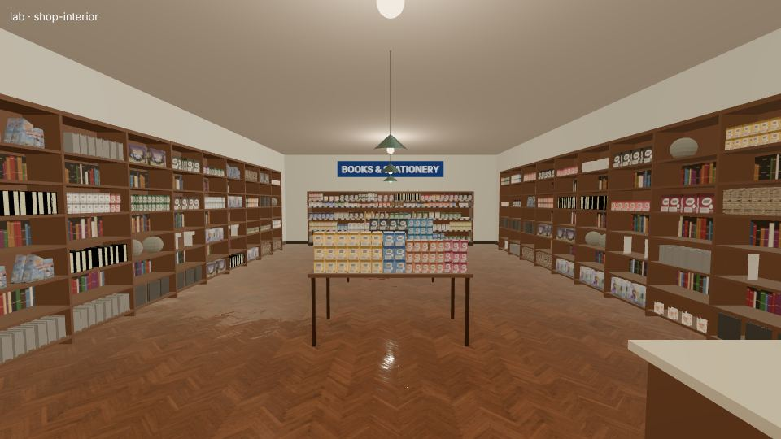
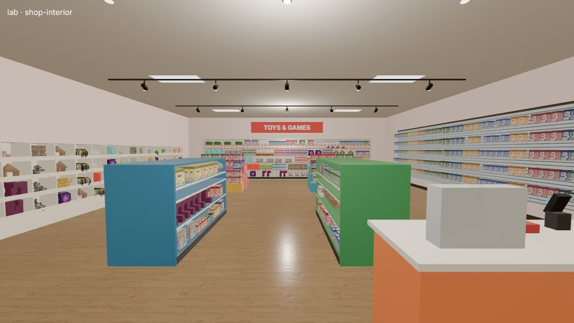

# Shop interiors: reference notes

Reference photos (Wikimedia Commons, looked at one by one) and what `src/shop.ts` copies from them.

| key | what | URL |
| --- | --- | --- |
| bodega2 | East Harlem bodega back corner: steel wire shelving, cat food, hand truck, stacked cases of water, grey wood-look vinyl plank floor, cat | https://commons.wikimedia.org/wiki/File:Bodega_cat_at_Heavenly_Market_IV%2C_1760_3rd_Avenue%2C_2024-06-27%2C_East_Harlem%2C_Manhattan%2C_New_York_06.jpg |
| deli1/deli2 | Yorkville "Gourmet & Deli": window counter with stools, rough reclaimed-wood wall planks, wooden cubby shelves of chips in their shipping boxes, cat on the counter | https://commons.wikimedia.org/wiki/File:%282026-03-08%29_Bodega_cat_at_1st_Avenue_Gourmet_%26_Deli%2C_741_1st_Ave%2C_Yorkville%2C_Manhattan%2C_New_York_01.jpg , https://commons.wikimedia.org/wiki/File:%282026-03-08%29_Bodega_cat_at_1st_Avenue_Gourmet_%26_Deli%2C_741_1st_Ave%2C_Yorkville%2C_Manhattan%2C_New_York_04.jpg |
| deli3 | deli counter: black glass-door cooler, overhead menu screens in a row, refrigerated case with curved glass sneeze guard, chip rack, 2x4 troffers, track spots | https://commons.wikimedia.org/wiki/File:Loebs_deli_washington_dc.jpg |
| cstore3 | corner-store counter: white laminate counter, register with customer display, card terminal, lollipop stand, glass shelves of spirits and cigarettes behind, 60 cm drop-ceiling tiles with recessed troffer | https://commons.wikimedia.org/wiki/File:Komal_Alimentation_G%C3%A9n%C3%A9ral-_corner_store_on_Avenue_Daniel_Boon_73_%28intersection_with_Rue_Francois_Bekaert%29_in_Auderghem%2C_Belgium%2C_inside_and_shopkeeper.jpg |
| cstore1 | gondola of soda: cases stacked on the bottom deck, 2-litre bottles fronted 6-deep, red shelf edges with price strips | https://commons.wikimedia.org/wiki/File:Leo%27s_Market_and_Eatery_-_October_2023_-_Sarah_Stierch_05.jpg |
| cstore2 | convenience store: black gondolas with green price strips and header signs ("Bakery", "Candy"), wall of glass-door coolers lit from inside, department words on the wall above the coolers | https://commons.wikimedia.org/wiki/File:Applegreen_Market%2C_New_York_State_Thruway_Junius_Ponds_Service_Area%2C_Junius%2C_New_York_-_20230102.jpg |
| cvs1 | CVS (Foggy Bottom, DC): continuous drop ceiling with 2x4 lay-in troffers in rows, hanging numbered aisle signs, dome cameras, grey carpet, endcaps and stacked cases in the main aisle, coolers along the back, big lowercase department words ("food", "beverage") on the walls | https://commons.wikimedia.org/wiki/File:Interior_shot_of_a_CVS_pharmacy_in_the_Foggy_Bottom_neighborhood.jpg |
| cvs2 | CVS (Belle View): same system | https://commons.wikimedia.org/wiki/File:Interior_of_CVS_Pharmacy%2C_Belle_View%2C_VA_-_1.jpeg |
| hw2 | old hardware store: pressed-tin ceiling, rolling library ladder on a rail along floor-to-ceiling wall shelving of drawers and boxes, long glass showcase counter, worn wood floor, pendant lamps | https://commons.wikimedia.org/wiki/File:Interior_of_Tenzer%27s_Hardware_Store%2C_St._Paul_%284418716325%29.jpg |
| elec2 | cluttered electronics/parts shop: narrow aisle, glass showcase counters, wall of small parts bins, wire spools, fluorescent tubes, wall fans, green-banded terrazzo floor | https://commons.wikimedia.org/wiki/File:DZ6_2542_A_narrow_cluttered_electronics_shop_aisle_lined_with_shelves_of_components_spools_of_wire_and_glass_display_cases_overflowing_with_parts.jpg |
| elec1 | electronics chain aisle: appliances on low plinths with price cards | https://commons.wikimedia.org/wiki/File:Washing_machine_aisle_in_a_Japanese_electronics_store.jpg |
| toys1 | toy/stationery store: white wall cubbies, colourful stepped display tables (yellow), track spotlights on a white ceiling | https://commons.wikimedia.org/wiki/File:Vibrant_Toy_and_Stationery_Store_Interior.jpg |
| guitar1 | guitar shop: instruments hung on wall hooks in two staggered rows, a few on floor stands, hard cases stacked, bright bare lamps | https://commons.wikimedia.org/wiki/File:Interior_of_a_Guitar_and_Ukulele_Shop.jpg |
| guitar3 | Lillo's Music Store guitars wall | https://commons.wikimedia.org/wiki/File:Lillo%27s_Music_Store_rare_guitar_collection_%2847926492931%29.jpg |
| antique1 | antique shop: ceiling full of chandeliers, warm dim light, dark wood chests and cabinets crowded together, rugs, things stacked on things | https://commons.wikimedia.org/wiki/File:Antique_shop_interior_-_Henfield_High_Street_-_geograph.org.uk_-_7059494.jpg |
| tin1 | pressed tin ceiling detail: 60 cm square embossed panels, raised border bead, painted | https://commons.wikimedia.org/wiki/File:Vox_Tin_Ceiling.jpg |
| furn2 | furniture store: drop ceiling with recessed downlights, coloured accent walls (orange, grey), vignettes on rugs, laminate wood floor, floor lamps | https://commons.wikimedia.org/wiki/File:Furniture_store_interior.jpg |
| plants1 | New Orleans plant shop: exposed joists, bare bulbs, gravel floor, slatted wooden benches crowded with pots, corrugated wall | https://commons.wikimedia.org/wiki/File:Harolds_Plants_NOLA_interior_1.JPG |
| plants2 | garden centre: brick-paver floor, tiered wood-edged display tables, steel shelving of pots | https://commons.wikimedia.org/wiki/File:Garden_centre_interior_with_indoor_plants%2C_GroenRijk.jpg |
| video1 | small store: dropped ceiling of speckled 2x2 tiles with stained grid, 2-lamp troffers, wire spinner racks, wood laminate floor, poster wall | https://commons.wikimedia.org/wiki/File:Interior_of_Viper_Video_video_store_in_Tampa%2C_Florida%2C_US%2C_on_30_October_2023_%2802%29.jpg |

## What to copy

**Ceilings.** Three kinds cover almost every NYC shop:
- *Drop ceiling* (chains, pharmacies, newer delis): 2x2 ft (0.61 m) off-white speckled mineral tiles in a white T-bar grid, 2x4 ft lay-in troffers (bright, cool 4000 K) every ~2.4 m, HVAC grilles, dome cameras. Ceiling 2.7-3.0 m.
- *Pressed tin* (old bodegas, hardware, antiques): 0.6 m embossed square panels with a bead border, painted cream/white (or copper/brown), 3.4-4 m high in old storefronts, with a cornice; bare fluorescent strips or pendants hung from it.
- *Exposed* (plant shops, boutiques, music stores): painted-black joists/ducts, track spotlights or bare bulbs.

**Floors.** Bodega: grey wood-look vinyl plank or 12" VCT checkerboard tiles; pharmacy: grey carpet or light VCT; hardware: worn wood planks; furniture/electronics: laminate wood; plants: concrete or brick pavers.

**Fixtures.**
- *Gondolas*: 1.4-1.8 m tall, 0.9-1.2 m deep doubled, 1.2 m (4 ft) sections, 4-6 shelves, kick-plate base deck; shelf edges carry coloured price strips (red/green/yellow) with white price tags; header sign on top or hanging aisle number.
- *Glass-door coolers*: walk-in style, 0.75 m doors, 2.1 m tall, black or silver frames, LED strip down each mullion so the bottles glow; 5-6 wire shelves, bottles fronted in rows 5-8 deep; brand header panel above.
- *Counter* (bodega): near the door, laminate top 1.0-1.05 m, register with pole display, card terminal on a stand, lollipop/candy racks and lighters on the counter, plexi lottery ticket dispenser; behind it, a wall rack of cigarettes (grid of coloured packs) and shelves of spirits/medicine; scratch-off ads and Lotto signs.
- *Deli counter*: refrigerated curved-glass case with lit interior (meats, cheeses), meat slicer on the back counter, overhead menu board (black with white text rows, often backlit or screens).
- *Hardware*: pegboard walls (brown hardboard or white, 1" hole grid) with hanging tools on hooks, slatwall, bins of fasteners, rolling ladders on high wall shelves, glass showcase counter.
- *Music*: guitars hung on wall hooks in staggered rows, amps on the floor, carpet or wood floor, warm track lighting, darker walls.
- *Toys*: low colourful display tables and cubbies, slatwall, bright light.
- *Antiques*: crowded, dark wood furniture as displays, glass cabinets, rugs, many chandeliers, warm low light (2700 K).
- *Furniture/lighting*: vignettes on rugs, accent walls, recessed downlights or track spots; lamps lit.
- *Plants*: tiered wooden benches, pots on the floor, gravel/concrete floor, bare bulbs, plenty of green.

**Density.** Real stores are crammed: shelves fronted to the edge, products 3-8 deep behind the front one, cases stacked on the floor at aisle ends, nothing in the middle is empty. Bodegas also stack boxes, water cases, hand trucks in corners.

**Signage.** Aisle numbers (hanging double-sided), department words on walls, yellow "SALE" / "2 for $5" shelf talkers, open/hours, EXIT sign, "No more than 2 students at a time"-style handwritten notes, ATM.

**Lighting.** Chains and bodegas: cool, bright, even (troffers/tubes). Coolers glow. Antiques/music/furniture: warm spots and pools of light, darker walls.

## What is built (src/shop.ts, src/shopkit/)

- `shopkit/layouts.ts`: one layout per shop type (room size, ceiling, floor, walls, light, fixtures).
  Bodega/deli: tin or drop ceiling, VCT checkerboard, glass-door coolers down one wall, gondolas, deli
  case + slicer/grill + menu board at the back, tobacco back bar, counter with register, card reader,
  lotto dispenser and candy, ATM, water cases, cat. Pharmacy: drop ceiling + troffers, aisles with
  numbered hanging signs, endcaps, floor stacks, coolers, pharmacy counter, department words. Hardware:
  pressed tin, pegboard wall, floor-to-ceiling shelving with rolling ladder, peg-backed gondolas, bin
  cabinet, glass showcase counter. Music: exposed ceiling, brick, guitar walls (2 staggered rows),
  amps, risers on rugs. Antiques: tin ceiling, dark walls, rugs, chandeliers, curio cabinets, one-of-each
  shelves. Furniture: vignettes on rugs. Plus toys, electronics, kitchen supply, lighting, sports,
  stationery/books, garden, models, machines.
- `shopkit/fixtures.ts`: the fixtures; `shopkit/tex.ts`: canvas textures (drop tile, pressed tin with
  normal map, VCT, pegboard, slatwall, price strips, cigarette rack, lotto tickets, menu board, rugs, book
  spines, TV screens); `shopkit/kit.ts`: builds fixtures in a local frame and records colliders,
  product segments and containers. Static fixtures are baked into a few meshes (`bake()`).
- Stock: fixtures emit segments (shelf, hook, pile, stack, single, ceiling). Products (sand3d pools for
  the shop, plus a few Google Scanned Objects / Poly Haven models from `src/libraries.ts`) are assigned
  where they fit near real size (wanted kinds first: drinks to coolers, instruments to guitar hooks),
  packed as fronted rows / stacks / heaps / hooks, instanced, and swapped to Objaverse originals within a
  2.5 M triangle budget. Blocks a product can't afford, and the rest of the shelf space, get generic
  packaging (`shopkit/filler.ts`: boxes, cans, bottles, jars, chip bags, blister cards, paint cans,
  pots with plants, guitars; one InstancedMesh per kind, tinted printed labels).
- Containers (coolers, showcases, curios, deli cases) stock lazily: `ShopLevel.containers[i].generate()`,
  called by `update()` when the player is near and in front.
- `ShopLevel.door` / `room` expose the street door (level coordinates) and room size.

Lab: `/?lab=shop-interior&type=<type>&seed=<n>&budget=<tris>&containers=closed`.

| | |
|---|---|
|  bodega aisle (cf. cstore1/cstore2) |  counter, tobacco rack, lotto (cf. cstore3) |
|  pharmacy (cf. cvs1) |  guitar walls (cf. guitar1) |
|  antiques (cf. antique1) |  furniture vignettes (cf. furn2) |
|  plant shop (cf. plants1) |  electronics |
|  books & stationery |  toys (cf. toys1) |

Screenshots are software-rendered at `--quality low` with a reduced product budget.
